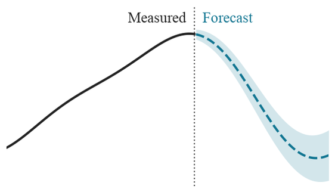
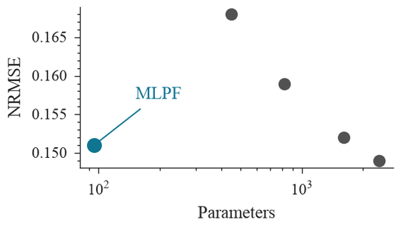

<div align="center">


[](https://github.com/sambaiga/twiga-thesis/actions/workflows/ci.yaml)
[](https://github.com/sambaiga/twiga-thesis/actions/workflows/security.yaml)
[](LICENSE)
[](pyproject.toml)
[](https://pypi.org/project/twiga/)

This repository includes the code needed to reproduce the results from each chapter of the thesis. To run the code, you will need [`twiga`](https://github.com/sambaiga/twiga-forecast), an open-source forecasting framework available on PyPI. Twiga was created as part of this PhD thesis.


</div>

<br>


## Chapters

| # | Chapter | RQ | |
|---|---|---|---|
| 1 | [Introduction](chapters/ch1_introduction/) | Setting the stage |  |
| 2 | [Background](chapters/ch2_background/) | Setting the stage |  |
| 3 | [Methodology](chapters/ch3_methodology/) | RQ1 |  |
| 4 | [MLPF](chapters/ch4_mlpf/) | RQ2 |  |
| 5 | [FPQR](chapters/ch5_fpqr/) | RQ3 |  |
| 6 | [Conformal Prediction](chapters/ch6_conformal/) | RQ3 |  |
| 7 | [Multi-Target Forecasting](chapters/ch7_multitarget/) | RQ4 |  |
| 8 | [Conclusion](chapters/ch10_conclusion/) | Synthesis | |

Each chapter folder has its own `README.md` with the exact reproduction command and the thesis
table/figure each output maps to. RQ3 covers both Chapter 5 (FPQR) and Chapter 6 (MLPGAM +
conformal calibration), per the thesis's own framing. Chapters 2, 3, 6 and 7 show that chapter's
own generated figure; Chapters 1, 4 and 5 show a small schematic illustrating the chapter's own
idea rather than a result figure (`scripts/generate_readme_thumbnails.py`). Every thumbnail shares
one canvas size so the table reads evenly.

## Installation

**Prerequisites:** Python 3.12+ and [`uv`](https://docs.astral.sh/uv/). Install `uv` with:

```bash
# macOS / Linux
curl -LsSf https://astral.sh/uv/install.sh | sh
```

```powershell
# Windows (PowerShell)
powershell -ExecutionPolicy ByPass -c "irm https://astral.sh/uv/install.ps1 | iex"
```

Then clone the repository and install its dependencies:

```bash
git clone https://github.com/sambaiga/twiga-thesis.git
cd twiga-thesis
uv sync --extra nn --dev
```

`--extra nn` installs `torch` and `lightning`, which every chapter's neural experiments
(Chapters 3-7) need. Without it, scripts fail with `ModuleNotFoundError: No module named
'lightning'`. `uv sync` removes packages that are not requested, so always pass `--extra nn` when
re-syncing. Check the install with:

```bash
uv run python -c "import lightning, twiga; from twiga_thesis import thesis_data_dir; print(thesis_data_dir())"
```

This should print the path to the repository's `data/` folder.

## Setup: data

All scripts read datasets from the repository's `data/` folder, whatever directory you run them
from. Datasets are not committed, so put them there before running anything:

1. **SPS-UK** (public, Chapters 3-7): download it from Zenodo and build `data/MLVS-UK.parquet`:

   ```bash
   uv run python -c "from twiga_thesis.datasets import fetch_sps_uk_raw, build_sps_uk_parquet; build_sps_uk_parquet(fetch_sps_uk_raw())"
   ```

2. **MLVS-PT** (unpublished, Chapters 3-7): available from the author on request. Save it as
   `data/MLVS-PT.parquet`.

3. **Chapter 7 power-flow records only** (`DSS-EU`, `DSS-UK`, `DSS-US`): set `EXTERNAL_DATA_DIR`
   to the root of a local `ml-energy-disaggregation` checkout:

   ```bash
   export EXTERNAL_DATA_DIR=/path/to/ml-energy-disaggregation      # macOS / Linux
   ```

   ```powershell
   $env:EXTERNAL_DATA_DIR = "C:\path\to\ml-energy-disaggregation"  # Windows (PowerShell)
   ```

[`data/README.md`](data/README.md) explains where each dataset comes from and how it is built.

## Running a chapter

Run each script with `uv run` so it uses the project environment:

```bash
uv run python chapters/ch4_mlpf/benchmark.py
```

Each chapter's own `README.md` lists its scripts, their order, and the thesis table or figure each
one produces.

<details>
<summary>Developing against an unreleased <code>twiga</code> change</summary>

```bash
uv add --editable ../twiga-forecast
```

</details>

## Tooling

Ruff, `ty`, pre-commit (Bandit, detect-secrets, Commitizen), and CI mirror `twiga-forecast`'s own
conventions.

```bash
uv run pre-commit install --hook-type commit-msg --hook-type pre-commit --hook-type pre-push
uv run ruff check . && uv run ruff format --check .
uv run ty check twiga_thesis chapters
uv run pytest
```

---

<div align="center">

Licensed under [Apache 2.0](LICENSE) · Built on [`twiga`](https://github.com/sambaiga/twiga-forecast)

</div>
