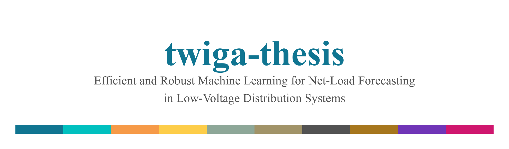
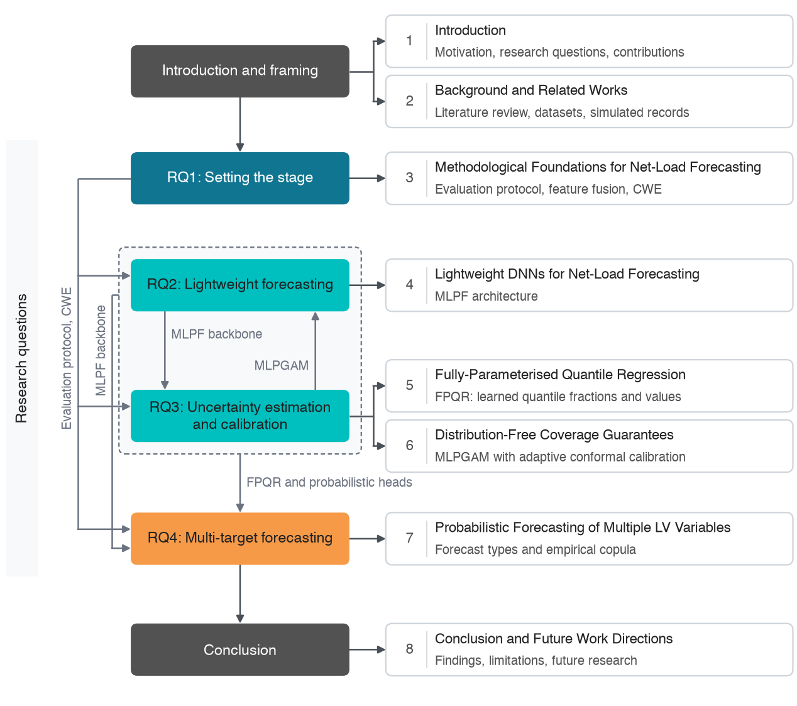
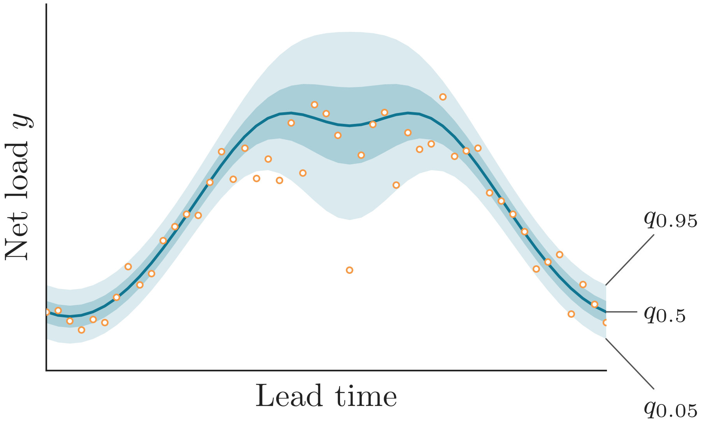
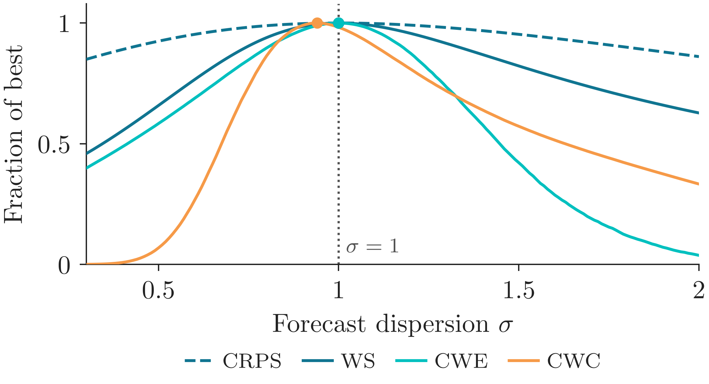
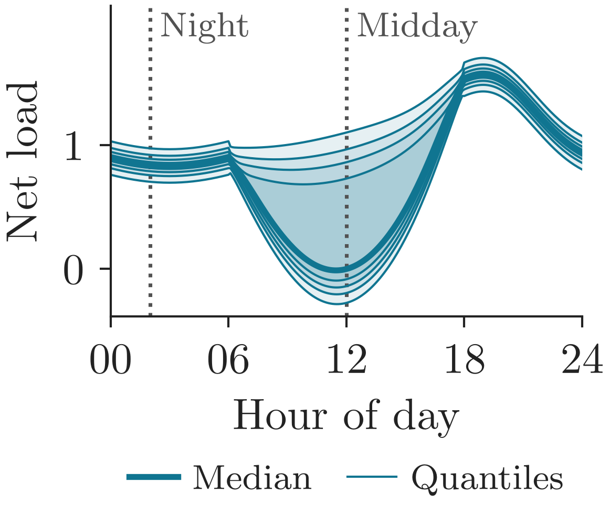
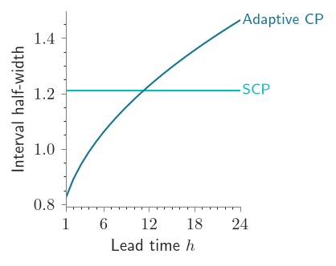
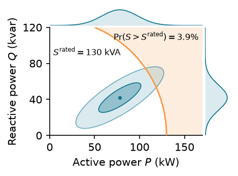

<div align="center">



[](https://github.com/sambaiga/twiga-thesis/actions/workflows/ci.yaml)
[](https://github.com/sambaiga/twiga-thesis/actions/workflows/security.yaml)
[](LICENSE)
[](pyproject.toml)
[](https://pypi.org/project/twiga/)

Per-chapter reproducibility code for the thesis. Depends on
[`twiga`](https://github.com/sambaiga/twiga-forecast) from PyPI, not vendored.

</div>

<br>



## Chapters

| # | Chapter | RQ | |
|---|---|---|---|
| 1 | [Introduction](chapters/ch1_introduction/) | Setting the stage |  |
| 2 | [Background](chapters/ch2_background/) | Setting the stage |  |
| 3 | [Methodology](chapters/ch3_methodology/) | RQ1 |  |
| 4 | [MLPF](chapters/ch4_mlpf/) | RQ2 | MLPF vs. ML/DNN baselines |
| 5 | [FPQR](chapters/ch5_fpqr/) | RQ3 |  |
| 6 | [Conformal Prediction](chapters/ch6_conformal/) | RQ3 |  |
| 7 | [Multi-Target Forecasting](chapters/ch7_multitarget/) | RQ4 |  |
| 8 | [Conclusion](chapters/ch10_conclusion/) | Synthesis | |

Each chapter folder has its own `README.md` with the exact reproduction command and the thesis
table/figure each output maps to. RQ3 covers both Chapter 5 (FPQR) and Chapter 6 (MLPGAM +
conformal calibration), per the thesis's own framing. Images are each chapter's own generated
output, not stock illustrations.

## Quickstart

```bash
uv sync --extra nn --dev   # omit --extra nn for Chapters 3-4 only (no torch needed)
```

<details>
<summary>Developing against an unreleased <code>twiga</code> change</summary>

```bash
uv add --editable ../twiga-forecast
```

</details>

## Data

See [`data/README.md`](data/README.md): MLVS-PT is unpublished (available from the author on
request); SPS-UK is public with a working fetch + assembly pipeline; Chapter 7's power-flow
records resolve via `EXTERNAL_DATA_DIR`.

## Tooling

Ruff, `ty`, pre-commit (Bandit, detect-secrets, Commitizen), and CI mirror `twiga-forecast`'s own
conventions.

```bash
uv run pre-commit install --hook-type commit-msg --hook-type pre-commit --hook-type pre-push
uv run ruff check . && uv run ruff format --check .
uv run ty check twiga_thesis chapters
uv run pytest
```

<details>
<summary>Notes from the initial reorganization</summary>

- All `chapters/` internal imports were converted from `sys.path.insert`-style and bare
  sibling-module imports to absolute package imports (`uv run ty check twiga_thesis chapters` is
  fully clean). This also caught a real bug: two output-artifact directories had been given
  `__init__.py` files, shadowing the real same-named `.py` modules.
- SPS-UK's raw-to-parquet pipeline (`twiga_thesis.datasets`) is verified end-to-end against the
  real Zenodo files. One assumption, averaging six weather stations into single Ghi/Temperature
  columns, isn't specified in the thesis text and couldn't be checked against the original
  parquet; see `data/README.md`.

</details>

---

<div align="center">

Licensed under [Apache 2.0](LICENSE) · Built on [`twiga`](https://github.com/sambaiga/twiga-forecast)

</div>
